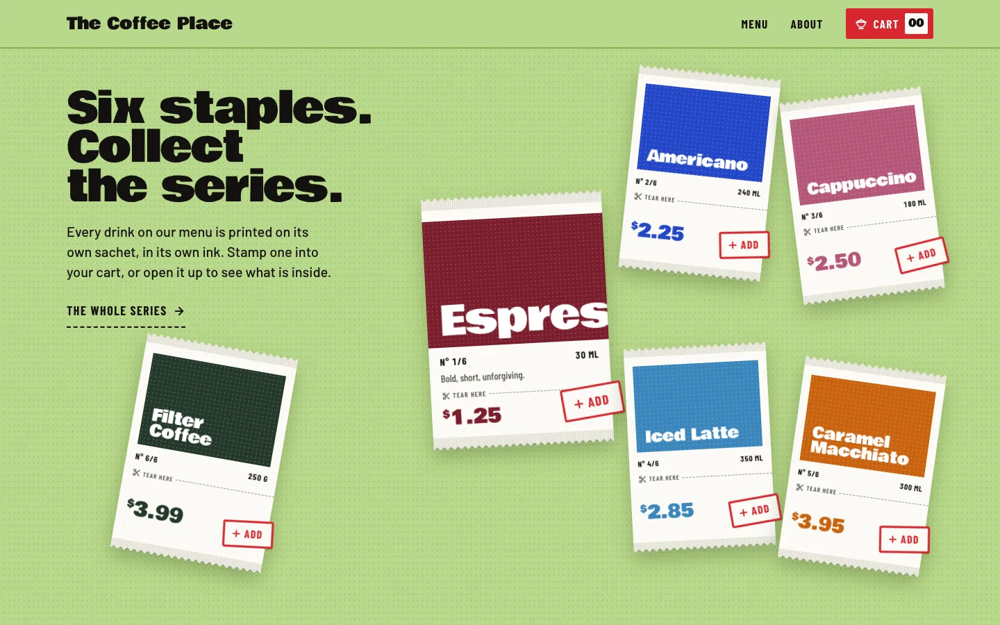
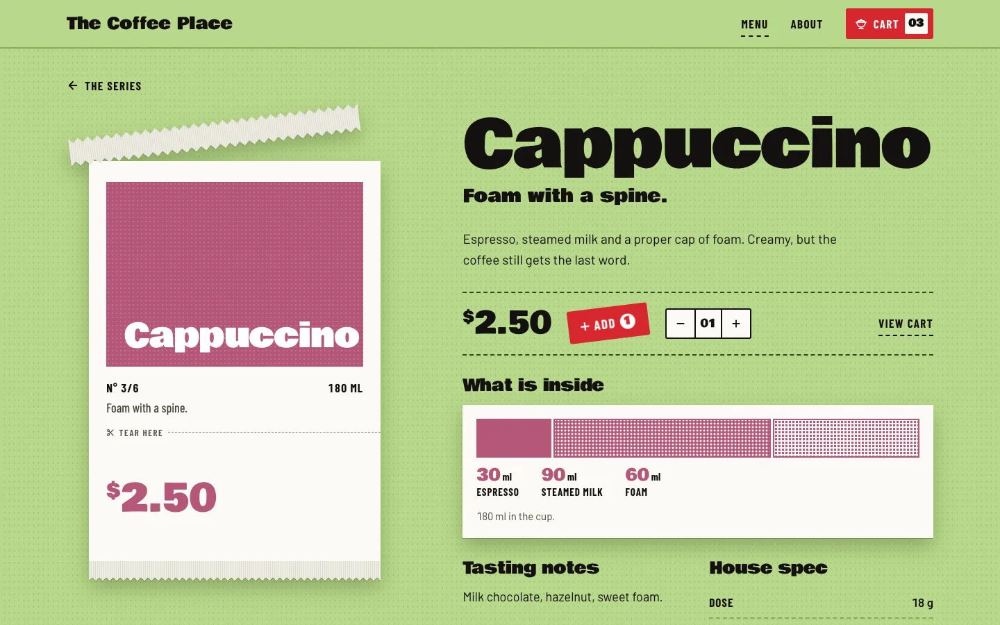
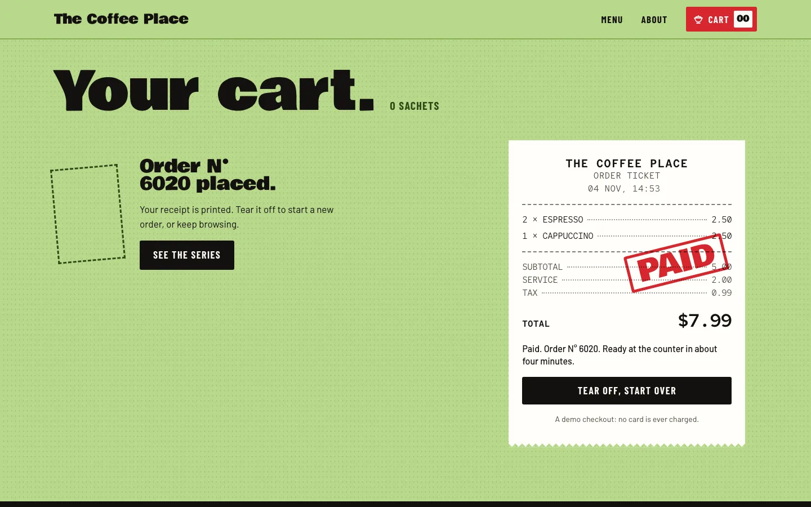
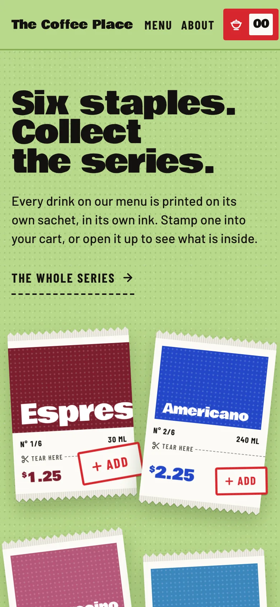

# The Coffee Place

A fictional coffee shop whose menu is a numbered series of six sugar sachets, each printed in its own ink on a pistachio café table. Browse the series, tear a sachet open, stamp drinks into the cart and pay to a printed receipt.

**Live:** [the-coffee-place.vercel.app](https://the-coffee-place.vercel.app/)



## What to try

- **Stamp a sachet.** The red “Add” stamp on every sachet adds it to the cart. The cart count in the header flips over, and the “Collect the series” card below fills in.
- **Tear one open.** Click any sachet. It morphs into its product page (React `ViewTransition`), the top seam tears off, and the drink's recipe pours into a halftone bar.
- **Reload the page.** The cart is kept in `localStorage` and stays in sync across open tabs.
- **Check out.** The receipt prints a line for every change. Paying stamps it PAID, and “Tear off, start over” tears it away. No card is charged; it is a demo.

| Product page | Cart and receipt | Phone |
| --- | --- | --- |
|  |  |  |

## Design

The visual world comes from Italian café sugar sachets, which bars print as collectible series.

- **Paper and print.** Sachets have pinked (zig-zag) edges and heat-sealed seams, both drawn with CSS masks. Tones come only from print: solid spot inks and halftone dot screens, with no gradients or glass.
- **One ink per drink.** Each product carries its own spot colour. Product photos are printed as duotones in that ink, and the black plate slides into register as you scroll (CSS scroll-driven animation).
- **Red means action.** The house red appears only on things you can press to buy: the Add stamps, the cart and Pay.
- **Type.** Bowlby One for the flexo-printed display lettering, Barlow Condensed for the small print, Barlow for reading, and Red Hat Mono only on the receipt.
- **Motion.** Sachets land on the table in series order, the cart count flips, the receipt feeds lines and the paid stamp thunks down. With `prefers-reduced-motion` set, all of it is static.

Design decisions are recorded in [`PRODUCT.md`](PRODUCT.md) and [`DESIGN.md`](DESIGN.md).

## Stack

- Next.js 16 (App Router, statically prerendered) and React 19
- styled-components 6 with the SWC compiler transform
- `ViewTransition` from React, enabled through `experimental.viewTransition`
- Cart state in a small external store read with `useSyncExternalStore`, so the server and client render the same markup
- Accessibility: keyboard-operable throughout, visible focus, a polite live region announces cart changes, and a skip link

## Running locally

```bash
npm install
npm run dev      # http://localhost:3000
npm run build    # production build
npm run lint
```

Built by [Maria Bonete](https://github.com/mbonete). Photos are stock imagery; the shop, its menu and its prices are fictional.
